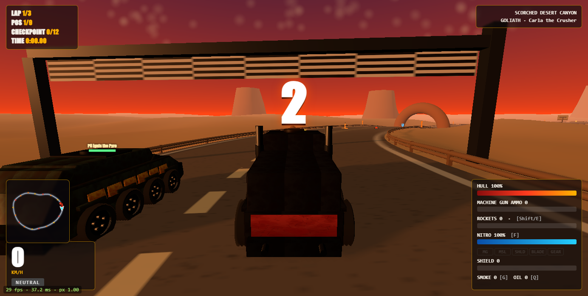
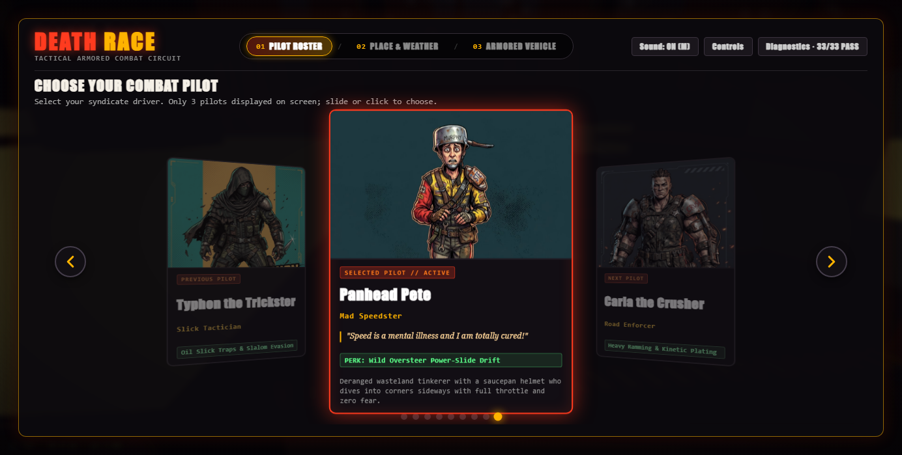
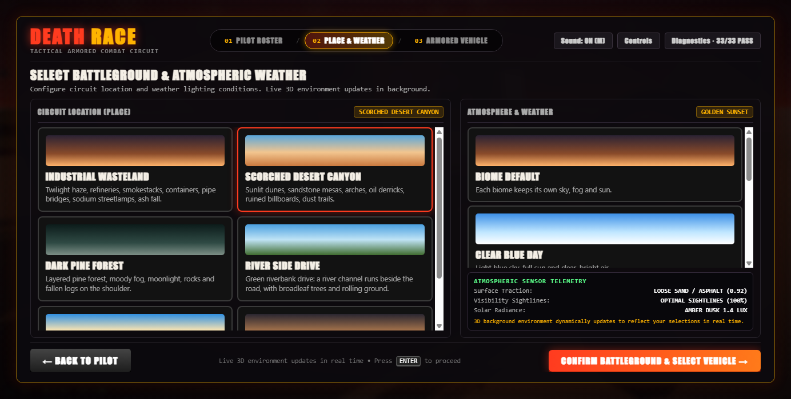
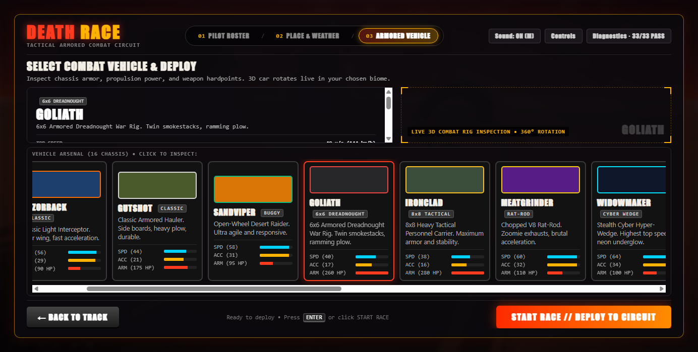
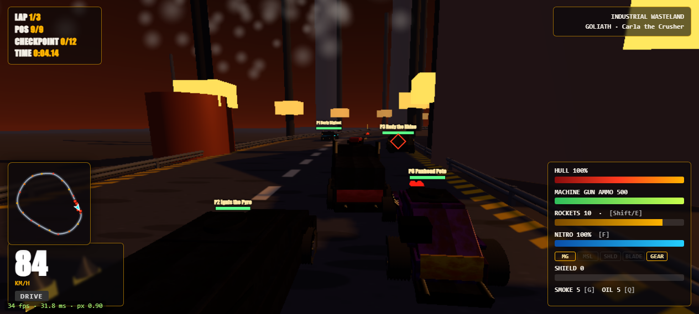
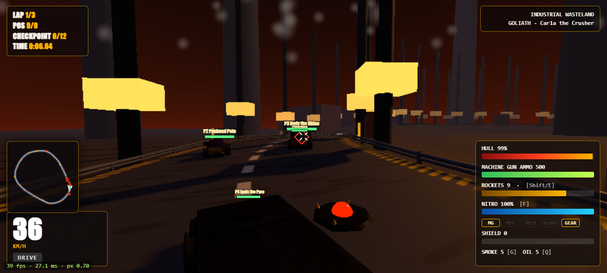
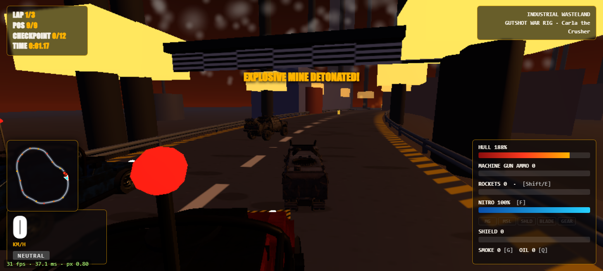
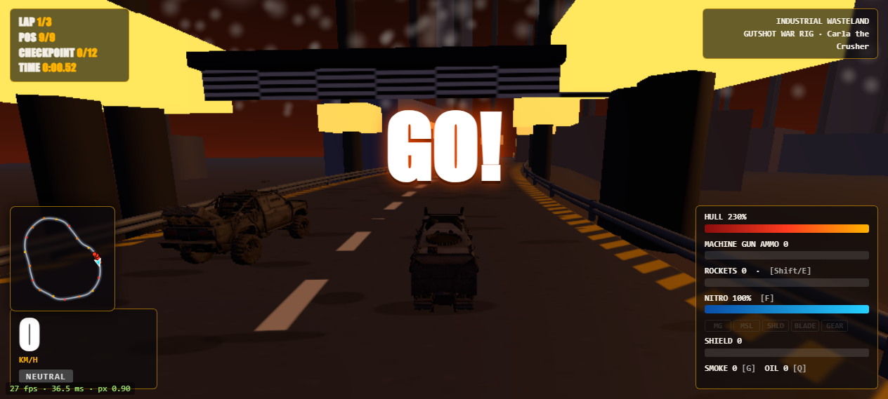

# DEATH RACE 3D — Post-Apocalyptic Vehicular Combat Circuit

[](https://en.wikipedia.org/wiki/HTML5)
[](https://threejs.org/)
[](https://www.khronos.org/webgl/)
[]()
[]()
[](LICENSE)

A high-octane 3D arcade vehicular combat racing game built in pure JavaScript with **Three.js** and an internal **120 Hz fixed-step physics engine**. Featuring 9 high-speed combat vehicles on track, independent roof turrets, homing missiles, road traps, dynamic powersliding, procedural track elevation, and a pro-grade 3-step menu system.



---

## Key Features

### 1. 120 Hz Fixed-Step Physics Loop
- **Authoritative Simulation (`PHYS_DT = 1 / 120`)**: Decoupled physics loop with sub-millisecond pose interpolation (`px, py, pz, ph`) for stutter-free 144Hz+ rendering.
- **SAT OBB Collision Resolution**: Separating Axis Theorem (SAT) Oriented Bounding Box collision solver handling car-to-car impact impulses and momentum transfers.
- **Analytical Vertical Curvature Airtime**: Hill crests, 2.2m jump ramps, and banked dips with suspension compression and airborne ballistic trajectory.
- **Combat Power-Slide & Drift (`Key [C]`)**: Tactical handbrake drift that lowers lateral tire grip (`grip × 0.42`), increases yaw authority, leaves dual asphalt tire skids, and generates micro-nitro charges on corner exit.

### 2. Pro-Grade 3-Step Menu Wizard

- **Step 1 — Pilot Selection**: High-impact character carousel showcasing 9 distinct wasteland drivers with unique quotes, specialties, backgrounds, and full-screen poster art.
- **Step 2 — Battleground Dossier**: Unified track and atmosphere selector combining 6 biomes with 5 dynamic lighting conditions (30 unique atmospheric combinations).
- **Step 3 — Combat Vehicle Garage**: Live interactive 3D vehicle viewport with dynamic specification dossier meters (Top Speed, Acceleration, Armor HP, Chassis Mass).




### 3. Combat Arsenal & Tactical Systems

- **Forward-Cone Auto-Tracking Roof Turret**: Auto-slews onto the nearest rival within a ±32° forward cone (up to 90m range) with screen-space 3D lock-on reticle.
- **Synthesized Hit-Confirm Ticks**: Crisp audio-visual crosshair tick on every landed shot.
- **Homing Rockets with 3D Track Following**: Rockets track real elevation over hills, ramps, and dips, triggering proximity detonations.
- **Rear Threat Radar Alert**: Flashing on-screen `⚠ MISSILE INCOMING` alert when an enemy rocket locks onto your vehicle.
- **Hazard Deployables**:
  - **Smoke Screens (`Key [G]`)**: Blinds chasing rivals, dampening their steering and targeting authority.
  - **Oil Slicks (`Key [Q]`)**: Destabilizes tire traction (`traction = 0.12`), causing uncontrolled wall slides.
  - **Roadside Explosive Mines**: Tactical landmines detonating upon tire contact with shockwave physics.
  - **Road Pickups**: Bullets, Missiles, Shield Overchargers, Kinetic Ramming Blades, Gear (Smoke/Oil), Repair Kits, and Nitro Canisters.




### 4. Tactical Radar & Killfeed

- **Real-Time Minimap Radar**: Lower-left corner canvas radar showing closed circuit geometry, player heading arrowhead, and colored rival dots.
- **Wasteland Killfeed**: Slide-in elimination banners announcing who wrecked whom in combat.
- **Procedural Web Audio Engine**: Zero external audio files required — engines, gunfire, missile launches, explosions, tire squeals, and horn beeps are synthesized on-the-fly via Web Audio API nodes.

---

## Vehicle Roster

| Vehicle | Class | 3D Asset | Speed | Accel | Armor | Specialty |
|---|---|---|:---:|:---:|:---:|---|
| **Razor Interceptor** | Light Apex | `DeathRaceCar1.glb` | 62 u/s | 33 | 85 HP | Blistering top speed & surgical drift agility |
| **Gutshot War Rig** | Dreadnought | `DeathRaceTruck.glb` | 42 u/s | 18 | 230 HP | 6-wheel heavy armor with massive ramming plow |
| **Beast Brawler 4x4** | Assault Brawler | `DeathRaceJeep.glb` | 52 u/s | 26 | 150 HP | Lifted roll cage stance with dual rapid cannons |
| **Bloodhammer** | Classic Muscle | 3D Rigged | 50 u/s | 25 | 130 HP | Balanced muscle chassis with heavy hood scoop |
| **Razorback** | Classic Interceptor | 3D Rigged | 56 u/s | 29 | 90 HP | Aerodynamic wing with fast rocket cycle time |
| **Gutshot Classic** | Classic Hauler | 3D Rigged | 44 u/s | 21 | 175 HP | Reinforced sideboards and durable steel frame |

---

## Pilot Roster

1. **Carla the Crusher** — *Road Enforcer* (`Heavy Ramming & Kinetic Plating`)
2. **Burly Bigfoot** — *The Mountain* (`Max Battering Mass & Wall Deflection`)
3. **Ace Falcon** — *Supersonic Daredevil* (`Top Speed Redline & Rapid Nitro Burns`)
4. **Ironfang Spike** — *Arena Gladiator* (`Close-Quarters Blade Shredding`)
5. **Razor Jack** — *Shadow Blade* (`Precision Drift Apex & Micro-Nitro`)
6. **Rudy the Rhino** — *Unstoppable Juggernaut* (`Armor Shock Absorption & Missile Armor`)
7. **Ignis the Pyro** — *Flame Bringer* (`Dense Smoke Obscuration & Blind Attacks`)
8. **Typhon the Trickster** — *Slick Tactician* (`Oil Slick Traps & Slalom Evasion`)
9. **Panhead Pete** — *Mad Speedster* (`Wild Oversteer Power-Slide Drift`)

---

## Biomes & Atmospheres

- **Biomes (6)**: Industrial Wasteland, Scorched Desert, Red Cedar Forest, Riverside Ruins, Neon Docks, Volcanic Caldera.
- **Lighting Conditions (5)**: High Noon, Golden Sunset, Midnight Run, Thunderstorm, Toxic Overcast.

---

## Controls

| Action | Primary Key | Secondary Key |
|---|:---:|:---:|
| **Accelerate** | `W` | `Up Arrow` |
| **Brake / Reverse** | `S` | `Down Arrow` |
| **Steer Left / Right** | `A` / `D` | `Left` / `Right Arrow` |
| **Combat Drift / Power-Slide** | `C` | — |
| **Machine Gun** | `Space` | — |
| **Fire Homing Rocket** | `E` | — |
| **Drop Smoke Screen** | `G` | — |
| **Deploy Oil Slick** | `Q` | — |
| **Nitro Boost** | `Shift` | `N` |
| **Horn / Taunt** | `H` | — |
| **Toggle Rear Camera** | `B` | — |
| **Mute Sound** | `M` | — |
| **Pause Game** | `Escape` | `P` |
| **Toggle Diagnostics** | `F1` | `~` |

*Controls can also be fully rebound in real time via the in-game keymapper.*

---

## Getting Started

### Prerequisites
- Modern web browser with WebGL support (Google Chrome, Microsoft Edge, Firefox, Brave).
- Python 3.x (recommended to host local files without browser CORS restrictions on 3D GLTF assets).

### Quick Launch (Windows)
Double-click **`run_game.bat`**. It spins up a local HTTP server and automatically opens your browser:
```bat
run_game.bat
```

### Manual Launch (macOS / Linux / Windows)
```bash
# Clone the repository
git clone https://github.com/Jameson040/DeathRace-Game.git
cd DeathRace-Game

# Start a lightweight local server
python3 -m http.server 8080

# Open in browser
open http://localhost:8080/death-race.html
```

---

## Architecture & Source Code

The game is built with a modular architecture in `src/` and compiled into a standalone production file `death-race.html`:

```
DeathRace-Game/
├── death-race.html                 # Complete standalone production game
├── Procedural_Vehicle_Generator.html# Standalone Three.js 3D vehicle generator
├── run_game.bat                    # One-click Windows launcher
├── build.ps1 / build.sh            # Production compiler scripts
├── assets/
│   ├── DeathRaceCar1.glb           # 3D Razor Interceptor GLTF model
│   ├── DeathRaceTruck.glb          # 3D Gutshot War Rig GLTF model
│   ├── DeathRaceJeep.glb           # 3D Beast Brawler 4x4 GLTF model
│   ├── characters/                 # Pilot character posters
│   ├── biomes/                     # Track biome thumbnails
│   ├── weather/                    # Atmosphere lighting thumbnails
│   └── vehicles/                   # Garage vehicle thumbnails
├── src/
│   ├── 00_head.html                # HTML head, styles, UI layouts & HUD DOM
│   ├── 01_core.js                  # Math utilities, RNG, canvas helpers
│   ├── 02_physics.js               # 120Hz physics, SAT OBB collision solver
│   ├── 03_track.js                 # Procedural 3D track generator & spline queries
│   ├── 04_builder.js               # Procedural car builder & Trellis GLTF loader
│   ├── 05_environment.js           # 6 Biomes, 5 lighting presets & obstacles
│   ├── 06_audio.js                 # Procedural Web Audio API sound synthesizer
│   ├── 06_combat.js                # Weapons, homing rockets, shields, pickups
│   ├── 07_ai_race.js               # AI driver logic, tactical combat, standings
│   ├── 08_hud_diag.js              # HUD overlay, minimap radar, 33-test diagnostics
│   ├── 09_game.js                  # State machine, menu flow, camera controllers
│   └── 99_tail.html                # Closing document tags
└── tools/
    ├── verify_cdp.py               # Automated 33-test CDP verification suite
    └── verify_pro_menu.py          # End-to-end menu & race integration suite
```

### Compiling from Source
```powershell
# Windows PowerShell
.\build.ps1

# Linux / macOS Bash
./build.sh
```

---

## Automated Verification Suite

The project includes an automated headless Chrome verification suite testing **33 critical engine systems**:
```bash
python tools/verify_cdp.py
```
```
Diagnostics complete! Total: 33, Passed: 33, Failed: 0, Errors: 0
[PASS] TEST_NO_MOUSE_STEER
[PASS] TEST_REVERSE_GEAR
[PASS] TEST_WALL_GLIDE_NO_STOP
[PASS] TEST_PROCEDURAL_CAR_QUALITY
[PASS] TEST_WEAPON_IMPULSE
[PASS] TEST_CHECKPOINT_LAP_PROGRESS
[PASS] TEST_AI_STUCK_RECOVERY
[PASS] TEST_COLLISION_PENETRATION
[PASS] TEST_NITRO_STATE
[PASS] TEST_PICKUP_COLLECTION
[PASS] TEST_DAMAGE_AND_DESTRUCTION
[PASS] TEST_NO_NAN_PHYSICS
...
ALL TESTS PASSED SUCCESSFULLY!
```

---

## License

This project is licensed under the [MIT License](LICENSE).
